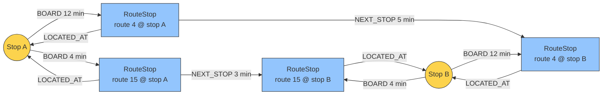

# Graph Design

This document describes the graph model stored in Neo4j: its nodes and
relationships, where they come from, and their role in the application.

## Nodes

### `Stop` (physical stop)

- **Source:** `stops.txt`
- **Properties (from the file):** `stop_id` (identifier), `stop_name`
  (user-facing name), `stop_lat` and `stop_lon` (coordinates)
- **Role in the graph:** the starting and ending point of queries ("How do I
  get from stop X to stop Y?")

### `RouteStop` (logical stop of a specific route)

- **Source:** a derived concept, obtained by joining `stops.txt` with
  `routes.txt` (via `trips.txt`)
- **Properties:** `route_stop_id` (unique identifier, e.g. the
  `{route_id}:{stop_id}` composite), `route_id`, `route_short_name`
  (e.g. "Line 15")
- **Role in the graph:** the actual point in the route topology that the
  pathfinding algorithm traverses

## Relationships (Edges)

### `[:LOCATED_AT]` (structural)

- **Direction:** `(RouteStop) -[:LOCATED_AT]-> (Stop)`
- **Source:** import logic (each unique `RouteStop` inherits its `stop_id` and
  is attached to the corresponding `Stop`)
- **Role:** anchors a `RouteStop` to its physical `Stop`. In pathfinding it is
  the free leg of arriving at a stop — the destination via its forward
  direction, the origin via its reverse — and, followed by `BOARD`, the first
  half of a transfer

### `[:NEXT_STOP]` (travel time)

- **Direction:** `(RouteStop) -[:NEXT_STOP]-> (RouteStop)` (within the same
  route)
- **Source:** `stop_times.txt` (sorted by `stop_sequence` for a given
  `trip_id`)
- **Properties:** weight `time`, in minutes (computed from the difference
  between the `arrival_time` at stop N+1 and the `departure_time` at stop N),
  averaged into a single constant value across all trips of a given route

### `[:BOARD]` (transfer wait)

- **Direction:** `(Stop) -[:BOARD]-> (RouteStop)`
- **Source:** one edge per `RouteStop`, derived from `stop_times.txt`
- **Properties:** weight `time`, in minutes, representing the expected wait
  for the next departure of the boarded route at that stop: half the average
  headway between the consecutive departures of that route's trips at that
  stop (arriving at a random moment, the expected wait is half the headway;
  use the full headway for a worst-case estimate). The value is specific to
  the (route, stop) pair — nothing is averaged across routes or stops —
  mirroring the static simplification already made by `NEXT_STOP` (one
  constant per (route, stop) instead of a timetable)
- **Role:** re-boarding the network on a new line at a stop. A transfer pays
  it: leaving the current line via `LOCATED_AT` into the shared `Stop` and
  `BOARD`ing the next line. Starting the journey does not: the search enters
  the graph directly at the origin's RouteStops (the query anchors there via
  the reverse `LOCATED_AT`), so neither the initial boarding nor the arrival
  at the destination costs anything

One `BOARD` edge per `RouteStop` carries the same information that pairwise
transfer edges between RouteStops would (the wait depends only on the
boarded route and the stop, not on the line arrived on) — without their
quadratic blow-up: a stop served by R routes would otherwise get
R × (R − 1) directed edges. For the Sweden feed this is 147 607 `BOARD`
edges instead of 11 167 762 pairwise ones; Stockholm C alone, served by
1 128 routes, would have contributed ~1.27 M edges on its own.

## Structure example

Two physical stops served by two routes, with all three relationship types
visible:



A journey from A to B on route 15 is `RS_15_A -NEXT_STOP 3→ RS_15_B
-LOCATED_AT→ STOP_B` — 3 minutes: entering the network at the origin and
arriving at the destination are free. Switching to route 4 at A pays `BOARD`:
`RS_15_A -LOCATED_AT→ STOP_A -BOARD 12→ RS_4_A -NEXT_STOP 5→ RS_4_B
-LOCATED_AT→ STOP_B` — 17 minutes. The wait depends only on the boarded route
(route 4 runs less frequently than route 15, so boarding it takes longer).
One `BOARD` edge per `RouteStop` carries the same information the pairwise
transfers would, without their quadratic blow-up.

## Pathfinding (example query)

Illustrates the shape of the search performed by `find_connection`: entering
the network at one of the RouteStops of the origin Stop (free — the anchor
traverses `LOCATED_AT` backwards), traveling along `NEXT_STOP` edges,
transferring through shared stops (`LOCATED_AT` into the `Stop`, then
`BOARD` out of it, paying the wait), and arriving at the destination Stop
via `LOCATED_AT` (free), minimizing the summed `time` weights. Plain Cypher
has no native weighted shortest path, so the query enumerates all paths up
to a hop bound and sums the weights with `reduce()`:

```cypher
// The hop bound (*..40; a transfer costs two hops) is a tuning constant.
MATCH (origin:Stop {stop_name: $origin})
MATCH (destination:Stop {stop_name: $destination})
MATCH p = (origin)<-[:LOCATED_AT]-(:RouteStop)
          -[:NEXT_STOP|LOCATED_AT|BOARD*..40]->
          (:RouteStop)-[:LOCATED_AT]->(destination)
WITH p, reduce(total = 0.0, r IN relationships(p) |
              total + coalesce(r.time, 0.0)) AS total_time
RETURN [n IN nodes(p) | coalesce(n.route_stop_id, n.stop_name)] AS stops,
       total_time
ORDER BY total_time
LIMIT 1;
```

Path enumeration is exponential in the hop bound, and cheaper connections
that would need more hops are invisible to the query. On larger networks the
[Neo4j Graph Data Science](https://neo4j.com/docs/graph-data-science/) plugin
offers a native Dijkstra; alternatively, the application can fetch the
topology through neodriver and run pathfinding client-side.

## Constraints and indexes

Before loading, `load_data` creates uniqueness constraints for the node
identifiers (a uniqueness constraint doubles as a range index for fast
lookups):

```cypher
CREATE CONSTRAINT stop_id IF NOT EXISTS
FOR (s:Stop) REQUIRE s.stop_id IS UNIQUE;

CREATE CONSTRAINT route_stop_id IF NOT EXISTS
FOR (rs:RouteStop) REQUIRE rs.route_stop_id IS UNIQUE;
```

Because `find_connection` resolves stops by their user-facing name, an index
on `stop_name` speeds up that lookup:

```cypher
CREATE INDEX stop_name IF NOT EXISTS
FOR (s:Stop) ON (s.stop_name);
```
