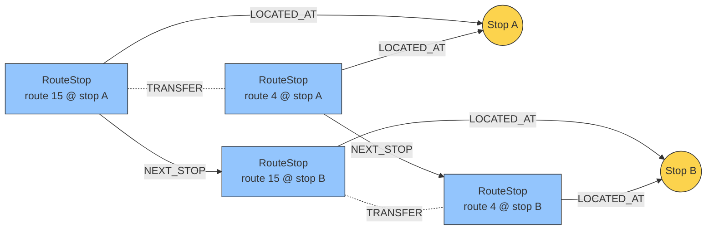

# Graph Design

This document describes the graph model stored in Neo4j: its nodes and
relationships, where they come from, and their role in the application.

## Nodes

### `Stop` (physical stop)

- **Source:** `stops.txt`
- **Properties (from the file):** `stop_id` (identifier), `stop_name`
  (user-facing name), `stop_lat` and `stop_lon` (coordinates)
- **Role in the graph:** the starting and ending point of queries ("How do I
  get from stop X to stop Y?")

### `RouteStop` (logical stop of a specific route)

- **Source:** a derived concept, obtained by joining `stops.txt` with
  `routes.txt` (via `trips.txt`)
- **Properties:** `route_stop_id` (unique identifier, e.g. the
  `{route_id}:{stop_id}` composite), `route_id`, `route_short_name`
  (e.g. "Line 15")
- **Role in the graph:** the actual point in the route topology that the
  pathfinding algorithm traverses

## Relationships (Edges)

### `[:LOCATED_AT]` (structural)

- **Direction:** `(RouteStop) -[:LOCATED_AT]-> (Stop)`
- **Source:** import logic (each unique `RouteStop` inherits its `stop_id` and
  is attached to the corresponding `Stop`)

### `[:NEXT_STOP]` (travel time)

- **Direction:** `(RouteStop) -[:NEXT_STOP]-> (RouteStop)` (within the same
  route)
- **Source:** `stop_times.txt` (sorted by `stop_sequence` for a given
  `trip_id`)
- **Properties:** weight `time`, in minutes (computed from the difference
  between the `arrival_time` at stop N+1 and the `departure_time` at stop N),
  averaged into a single constant value across all trips of a given route

### `[:TRANSFER]` (transfer time)

- **Direction:** `(RouteStop) -[:TRANSFER]-> (RouteStop)` (between different
  routes)
- **Source:** generated logically for all `RouteStop` nodes connected (via
  `LOCATED_AT`) to the same `Stop` node
- **Properties:** weight `time` representing the time needed to make the
  transfer, averaged across all trips

## Structure example

Two physical stops served by two routes, with all three relationship types
visible:



`TRANSFER` edges are drawn without arrowheads because they are traversable in
both directions; in the database they are stored with a direction (as all
Neo4j relationships are), which queries simply ignore.

## Pathfinding (example query)

Illustrates the shape of the search performed by `find_connection`: starting
from the RouteStops located at the origin Stop, traverse `NEXT_STOP` and
`TRANSFER` edges to reach the RouteStops at the destination Stop, minimizing
the summed `time` weights. With the
[Neo4j Graph Data Science](https://neo4j.com/docs/graph-data-science/) plugin
this can be expressed directly in Cypher:

```cypher
// One-time: project the pathfinding subgraph.
CALL gds.graph.project(
    'transport',
    'RouteStop',
    { NEXT_STOP: { properties: 'time' },
      TRANSFER:   { properties: 'time' } });

// Best connection from $origin to $destination.
MATCH (origin:RouteStop)-[:LOCATED_AT]->(:Stop {stop_name: $origin})
MATCH (destination:RouteStop)-[:LOCATED_AT]->(:Stop {stop_name: $destination})
CALL gds.shortestPath.dijkstra.stream('transport', {
    sourceNode: origin,
    targetNode: destination,
    relationshipWeightProperty: 'time' })
YIELD totalCost, path
RETURN [n IN nodes(path) | n.route_stop_id] AS route_stops,
       totalCost AS total_time
ORDER BY total_time
LIMIT 1;
```

The query is illustrative — whether pathfinding ultimately runs inside Neo4j
(as above, which requires the GDS plugin) or in the OCaml application after
fetching the topology is an implementation decision; the shape of the search
is the same either way.

## Constraints and indexes

Before loading, `load_data` creates uniqueness constraints for the node
identifiers (a uniqueness constraint doubles as a range index for fast
lookups):

```cypher
CREATE CONSTRAINT stop_id IF NOT EXISTS
FOR (s:Stop) REQUIRE s.stop_id IS UNIQUE;

CREATE CONSTRAINT route_stop_id IF NOT EXISTS
FOR (rs:RouteStop) REQUIRE rs.route_stop_id IS UNIQUE;
```

Because `find_connection` resolves stops by their user-facing name, an index
on `stop_name` speeds up that lookup:

```cypher
CREATE INDEX stop_name IF NOT EXISTS
FOR (s:Stop) ON (s.stop_name);
```
